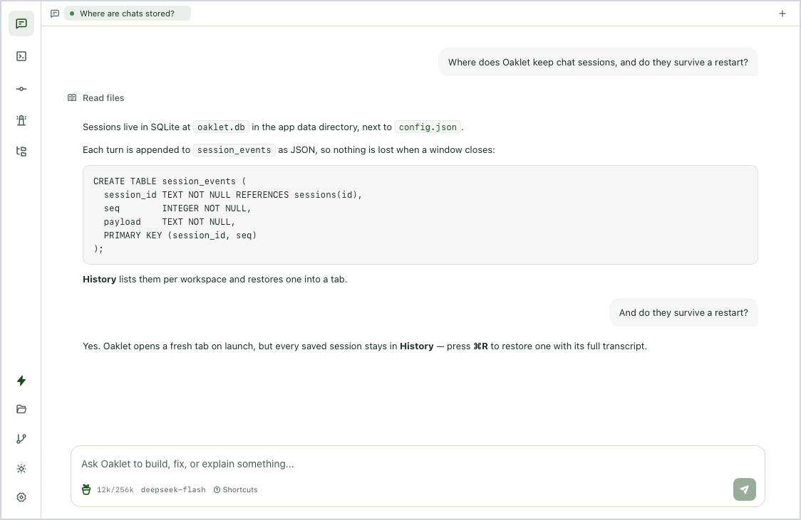

<p align="center">
  
</p>

# Oaklet

A local code agent with a Tauri 2 desktop shell: React/TypeScript UI, Rust agent
runtime. Inspired by the host-side loop, scoped tools, and explicit approvals in
[DeepSeek Harness](https://github.com/deepseek-ai/deepseek-harness).

<p align="center">
  
</p>

## Install

Oaklet currently supports macOS only (Apple Silicon and Intel). Windows and
Linux are not supported yet.

Download the `.dmg` for your Mac from
[Releases](https://github.com/FishwithCat/Oaklet/releases/latest).

- Use `_aarch64.dmg` on **Apple Silicon (M-series)**.
- Use `_x64.dmg` on **Intel**.

Older releases may offer a `_universal.dmg` that works on both. Open the `.dmg`
and drag Oaklet into Applications. If no build is available there, see
[CONTRIBUTING.md](CONTRIBUTING.md) to build from source.

If macOS blocks the first launch of an ad-hoc signed build, open Oaklet once
and use the steps for your version of macOS.

- **macOS 15 or newer**: **System Settings → Privacy & Security → Open Anyway**.
- **macOS 14 or earlier**: right-click Oaklet and choose **Open**.

Or clear the quarantine flag from Terminal:

```sh
xattr -dr com.apple.quarantine /Applications/Oaklet.app
```

The Architecture view and the `likec4_mcp` tool need Node.js 22.23.3 or newer.
Oaklet finds it on `PATH`, in common install locations, or via `OAKLET_NODE`;
the rest of Oaklet works without it.

## Quick start

1. Click the folder icon in the sidebar and choose a workspace. It opens in its
   own window; repeat to work on another project, and each new window steps down
   and to the right of the last so neither hides the other. File tools stay
   inside each window's workspace.
2. Open **Settings**, use the **Model** tab, enter an API key, and choose a Base
   URL and model. DeepSeek is the default.
3. Describe a change and send it. The agent reads and edits files, runs commands
   (without an approval card by default), and streams the result into the chat.

To build Oaklet from source, see [CONTRIBUTING.md](CONTRIBUTING.md).

## Chat

- Multiple tabs, each titled by its first prompt and with its own conversation
  and draft. **⌘N** opens a tab, **⌘X** closes the active one, and **⌘R** opens
  History, where you can restore a saved session. Sessions live in
  the backend, so they survive a restart; a live run keeps streaming while you
  switch tabs, but quitting Oaklet stops it and the next start marks it
  interrupted.
- Each window belongs to one workspace. Opening the same folder again focuses
  its existing window instead of creating a second one. A second app launch
  focuses the last active window; `oaklet --workspace <path>` opens or focuses
  that workspace. Closing a workspace window stops its runs, terminals,
  background jobs, and cached MCP servers.
- Paste screenshots or text files into the composer. Images are downscaled and
  sent as image parts, so the configured model must accept image input; text
  files up to 200 KB are accepted, and files above 16 KB are saved under
  the app data directory's `spill` folder with only a head/tail preview
  inlined. Spill files older than 30 days are removed at startup.
- Replies stream as Markdown. Thinking and tool calls fold into compact,
  expandable process rows. `write_file`, `edit_file`, and `apply_patch` show an
  inline diff card with the applied changes and their added/removed line counts.
- **⌘F** finds text in the open conversation and highlights every match;
  **Enter** and **Shift+Enter** step through them.
- Select text in chat and click **Send to Terminal** to run it in the active
  terminal tab.
- **Stop** cancels the model request, a running command, or a pending approval.
- Closing a window or quitting with **⌘Q** asks before discarding unsaved file
  edits or stopping a running chat. Oaklet waits for cancelled work and session
  writes before exiting; if a reply cannot be saved, the window stays open and
  closing it again retries the save.
- Long transcripts open on the latest page; scroll up and choose **Load earlier**
  to bring in older turns without reading the whole log.
- The plant in the composer's top-left corner estimates the next request against
  the context window and turns from green to yellow to red. Hover it for the
  percentage and token counts; click it while idle to fold older turns into a
  checkpoint immediately. Replaced messages stay in the transcript, so a
  compacted chat can page through the originals with `history_read` instead of
  losing them. Archived images can be reattached with
  `history_read(offset=N, image=M)` using the locator shown in a history page.
- Compaction failures preserve history and stop the run for retry. Successful
  tool-output trims remain recoverable even if a later summary fails. A separate
  **Summary model** requires its own **Summary context window** in Settings.

The agent has `read_file`, `file_outline`, `read_image`, `write_file`, `edit_file`,
`apply_patch`, `list_dir`, `glob`, `grep`, `structural_search`, `run_command`, `job_list`,
`job_output`, `job_kill`, `web_fetch`, and `likec4_mcp`; depending on your setup
it also has `skill`, MCP server tools, `web_search`, and, after compaction,
`history_read`.

`file_outline` lists declarations and line ranges from saved Rust, JavaScript
(including JSX), TypeScript (including TSX), Python, and Java files, so the
agent can read the relevant implementation by line range.

`structural_search` finds `invoke(...)` calls in JavaScript or TypeScript and
function definitions marked with `#[tauri::command]` or `#[test]` in Rust.
File edit tools report suspected syntax errors introduced by successful edits
in the same languages as `file_outline`.

## Workspace views

Each workspace window has its own Chat tabs, Terminal tabs, Files editor, Git
view, Architecture view, and Skills scan. They all use that window's folder;
another window can be on a different project at the same time. Oaklet is still
one application instance and one SQLite database, so settings and history are
shared while sessions remain grouped by workspace.

**Terminal** is backed by real PTYs: multiple tabs, interactive shells, colors,
job control (`Ctrl+C`), and 5,000 lines of scrollback, starting in the
workspace.

**Files** browses the workspace as a tree and opens files in an editor. Markdown
can be previewed, and **⌘S** saves. Use **File outline** in a saved Rust,
JavaScript, TypeScript, Python, or Java file to jump to its declarations.

**Source control** has **Changes** (uncommitted files with diffs) and
**Commits** (last 100 commits, and the diff of each with per-file stats). The
sidebar badge counts uncommitted changes. Diff previews are limited to
1 MiB, show one file at a time, and paginate at 200 lines. Where source
versions are available, changed symbols link to their first diff hunk.

The branch icon below the workspace button in the sidebar switches the
workspace's branch. The menu filters branches as you type and refreshes them on
open; its refresh button picks up branches created outside Oaklet. Switching is
refused while a chat is running, asks before carrying uncommitted changes to the
new branch, and closes the open file because its contents may change.

**Architecture** discovers LikeC4 models in the workspace and renders their
views. Test support directories (`fixtures`, `__fixtures__`, `testdata`) are
skipped so intentionally broken fixture models do not shadow the workspace
model, and `exclude` patterns in a JSON `likec4.config.json` are honored.
**Generate architecture** and **Update with agent** put an editable prompt in
the composer without discarding your draft; the normal chat flow still sends,
approves, and can cancel it. Viewing an existing model never calls the model
provider. The view re-reads when activated, on **Refresh**, and after an agent
run finishes or fails; it keeps the last valid diagram, marked stale, while new
sources are invalid. It does not watch the filesystem.

## Settings

Open **Settings** in the sidebar. Changes apply to the next run.

| Setting                       | Default                                    |
| ----------------------------- | ------------------------------------------ |
| API key                       | none                                       |
| Base URL                      | `https://api.deepseek.com`                 |
| Model                         | `deepseek-flash`                           |
| Summary model                 | same as Model                              |
| Context window                | `262144` tokens                            |
| Run commands without approval | on                                         |
| Search provider               | DeepSeek                                   |
| Search API key                | none (DeepSeek falls back to API key)      |
| Search URL                    | provider default                           |
| MCP servers                   | none                                       |
| Workspace                     | the last opened workspace                  |

For another OpenAI-compatible provider, set its base URL (for example
`https://api.openai.com/v1`) and model. For a local setup with
[Ollama](https://ollama.com), use `http://localhost:11434/v1` and a model such
as `qwen2.5-coder`.

## Skills

Skills are reusable Markdown instructions the agent loads only when a task
matches. Oaklet scans these folders (no recursion) at the start of every run; a
higher row wins a duplicate name:

| Priority | Folder                       |
| -------- | ---------------------------- |
| 1        | `<workspace>/.oaklet/skills` |
| 2        | `<workspace>/.agents/skills` |
| 3        | `~/.oaklet/skills`           |
| 4        | `~/.agents/skills`           |

A skill is either a directory containing `SKILL.md` or a flat `<name>.md`:

```markdown
---
name: review
description: Review a pull request for correctness, lifecycle, and test gaps.
whenToUse: When the user asks for a code review.
disable-model-invocation: false
user-invocable: true
---

# Reviewing a change

Read the diff first...
```

`name` must be lower-case kebab-case and `description` is required. Set
`disable-model-invocation: true` to keep the model from loading a skill;
`user-invocable` is reserved for future `/name` invocation. The model sees a
summary and calls `skill({"name":"review"})` to load the full body. Bodies are
re-read on each load, so edits apply to the next call, and relative references
resolve from the skill's own directory. Skill files are limited to 256 KiB and
bodies to 24,000 characters.

The **Skills** icon in the sidebar lists discovered skills, their source and
invocation flags, and any skipped files. **Refresh** rescans immediately; the
popup is read-only.

## MCP servers

**Settings → MCP** connects Oaklet to other MCP servers. The tab edits the
standard `mcpServers` document:

```json
{
  "mcpServers": {
    "zhihu": {
      "type": "streamableHttp",
      "url": "https://developer.zhihu.com/api/mcp/v1",
      "headers": {
        "Authorization": "Bearer your_access_secret"
      }
    },
    "files": {
      "type": "stdio",
      "command": "npx",
      "args": ["-y", "@modelcontextprotocol/server-filesystem", "/workspace"],
      "env": {}
    }
  }
}
```

`type` is `stdio` or `streamableHttp` (`http` and `streamable_http` are also
accepted). When omitted, a command selects stdio and a URL selects Streamable
HTTP. Add `"enabled": false` to pause a server, or use the toggle list below the
editor. Changes apply to the next run.

MCP tools run without an approval prompt. Only enable servers and credentials
you trust: a configured command runs with your user privileges, and an HTTP
server can receive the headers entered here. Tool output is treated as external
data, never as instructions.

## Web search

With a usable key — the search key, or the model API key when the search key is
empty — the agent also gets `web_search`. It sends one query to the configured
endpoint and requests up to 10 results with title, URL, excerpt, and date,
within 20 seconds. It asks for no approval: it sends only the query, never
workspace content.

**Settings → Web Search** sets the key and endpoint. The endpoint defaults to
the DeepSeek Search API and must speak that API. An empty search key sends the
model key to whatever host the endpoint names, so point it only at a host you
trust. Without a key the tool is not registered, so the model never sees it.

`web_fetch` is always available and does not need a search key. It returns up
to 200,000 characters and reduces HTML to readable text.

## Approvals and safety

- File tools resolve paths against the canonical workspace root and reject `..`
  escapes, symlinked escapes, and writes inside `.git`.
- `run_command` runs through your shell in the workspace and times out after
  120 seconds. Each output stream keeps its last 1 MB and continues reading
  after that limit, so verbose commands finish normally. Set
  `run_in_background` to start a long build
  or server; it returns a job id, keeps running after the chat turn, and is read
  and stopped with `job_output`/`job_kill` (or `job_list`). Background jobs have
  no timeout and are stopped when Oaklet exits. When one finishes, the chat that
  started it is told: a busy turn receives the result on its next step, and an
  idle one opens a turn so the model can report it (up to eight such wakes
  between two user messages). **Settings → Commands → Run
  commands without approval** is on by default, so commands run without an
  approval card; turn it off to see each command first.
- `job_kill` requests cancellation and reports the job as stopping until its
  processes exit. A shell exiting before its child processes does not release
  the background job; closing the workspace also stops those processes.
- `web_fetch` reads any HTTP(S) URL and returns bounded text. It can reach
  localhost and private addresses, so treat fetched content as untrusted data.
- **Allow all in workspace** on an approval card stops prompting in that
  window's workspace for the rest of the app session. The sidebar toggle grants
  or revokes it (revoking asks first). Grants never apply to file tools or
  another workspace, and
  commands can still touch files outside the workspace, so allow them only in a
  project you trust.
- Commands typed in the terminal run immediately in the workspace, without
  model involvement, approval, or a timeout.
- MCP tools run without approval and can reach anything their server can. Their
  output is model input, not trusted instructions.
- Architecture preview parses model sources in the local, pinned helper. It does
  not execute workspace configuration or JavaScript.
- The agent stores the API key in the app config directory (`0600` on Unix),
  never in the repository.

## Logs

Release builds append key diagnostics (a session that failed to save, stale runs
recovered at startup) to `oaklet.log` in the platform log directory, for example
`~/Library/Logs/com.oaklet.desktop/oaklet.log` on macOS.

## Status

Initial MVP. Open chat tabs and drafts are in memory (a restart clears them;
every session remains in History), there is no multi-device server, and chat
code blocks have no syntax highlighting.

## License

Apache License 2.0. See [LICENSE](LICENSE).

## Contributing

Development setup, tests, packaging, and architecture notes are in
[CONTRIBUTING.md](CONTRIBUTING.md).
